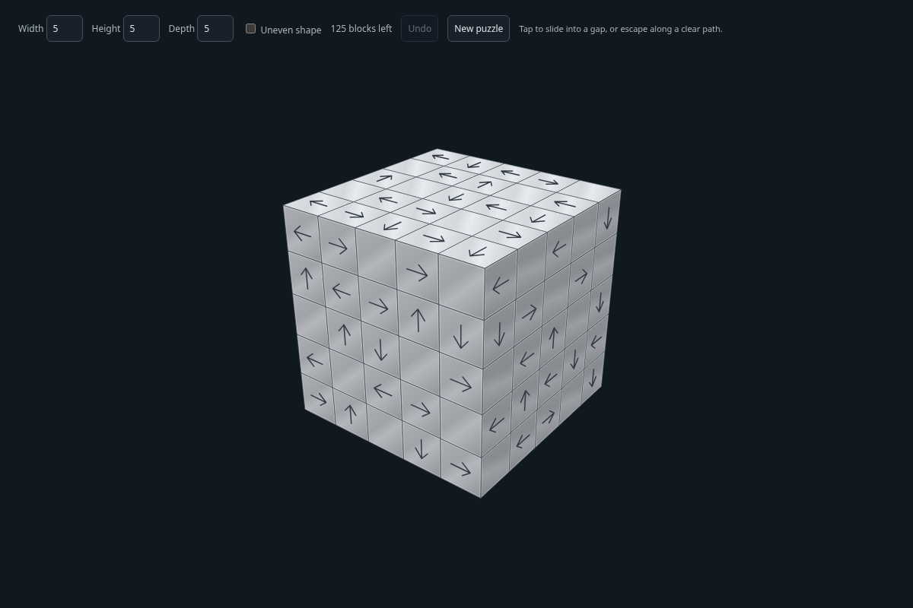
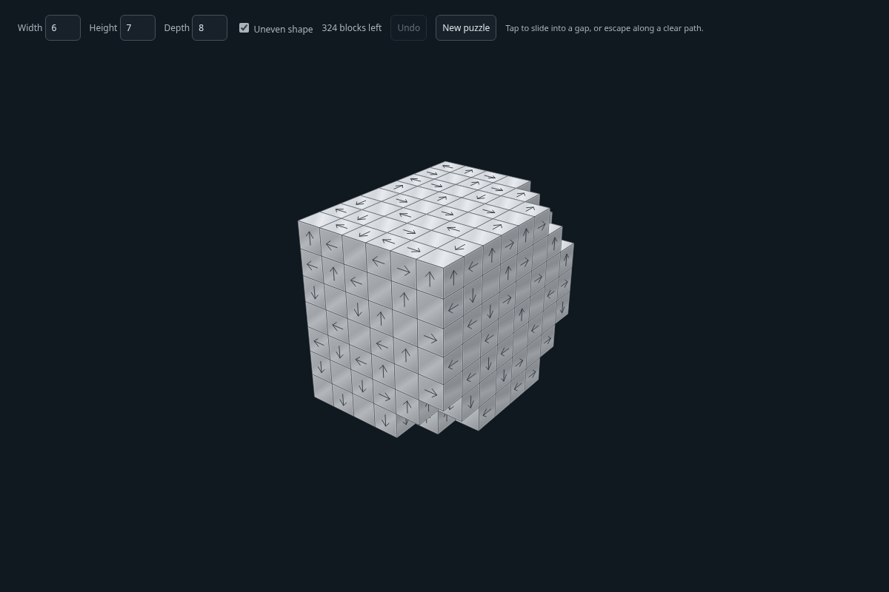

# Cubenikal

Cubenikal is a dependency-free 3D puzzle made with vanilla JavaScript and the HTML canvas. Clear a shape by moving each block in the direction of its arrows.



## Get started

You need Python 3 and a modern browser. From the project folder, run:

```sh
python3 -m http.server 8000
```

Open [http://localhost:8000](http://localhost:8000). Press `Ctrl+C` in the terminal to stop the server. There are no packages to install or build steps.

## Play

- Set **Width**, **Height**, and **Depth** independently, from 5 to 15 blocks. Choose **Uneven shape** for a shape with stepped corners, then select **New puzzle**.
- Drag the puzzle to rotate it. Scroll to zoom, or pinch on a touch screen.
- Tap or click a block to move it along its arrow. It flies out if its path is clear, slides into a gap if there is room, or stays put if the next block is in the way.
- Select **Undo** to reverse a move. Undo is unlimited for the current puzzle.
- Select **New puzzle** or press **R** to generate another puzzle with the current settings.
- Clear every block to advance automatically. Each dimension increases by two, up to 15; the uneven setting stays selected if enabled.



Puzzles are generated locally with a valid sequence of block removals. The generator searches for a challenging layout; when it cannot meet every difficulty target within its search limit, it uses the best solvable layout it found.

## Project files

- `index.html` contains the controls and canvas.
- `style.css` styles the interface.
- `game.js` handles rendering, picking, input, puzzle generation, movement, and undo.
- `docs/images/` contains the screenshots used above.
